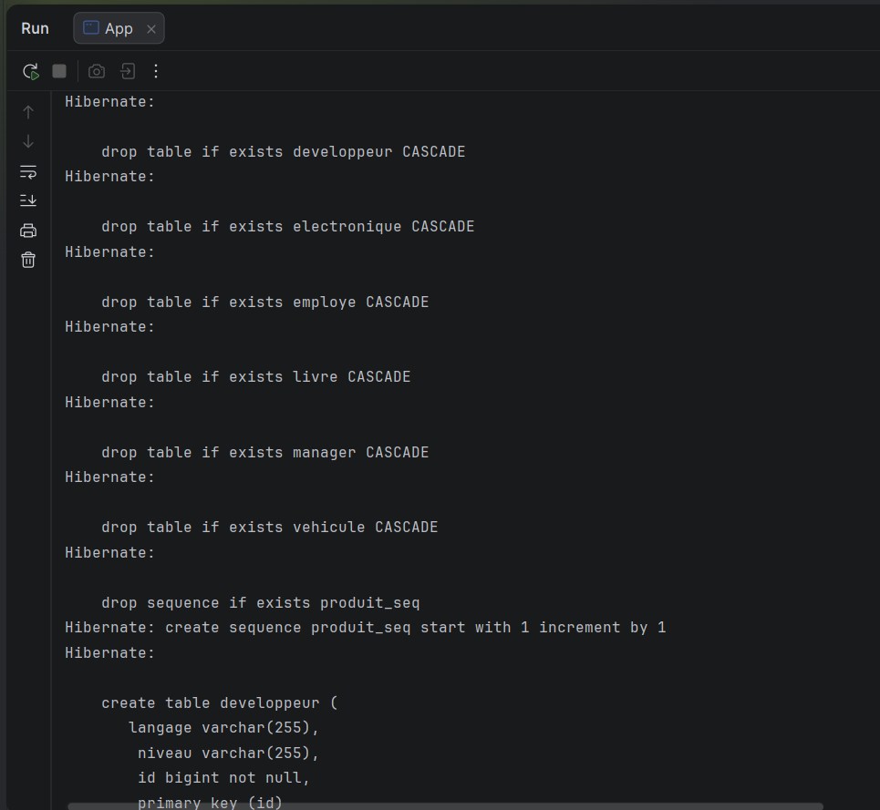
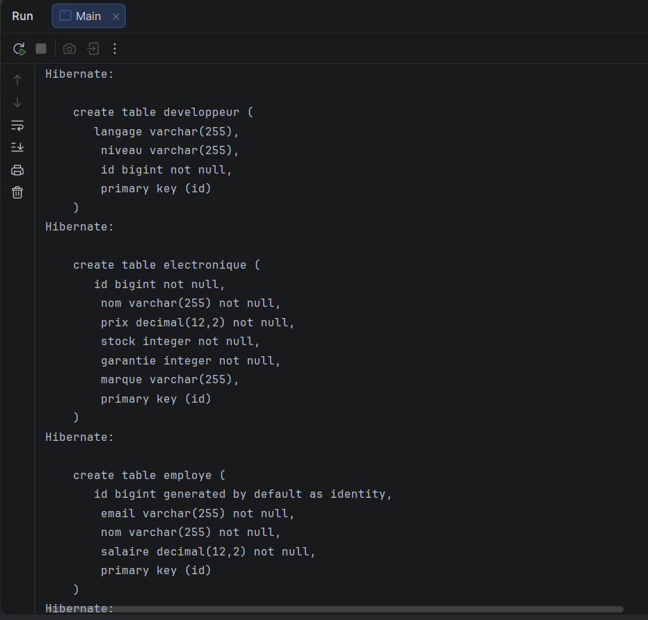
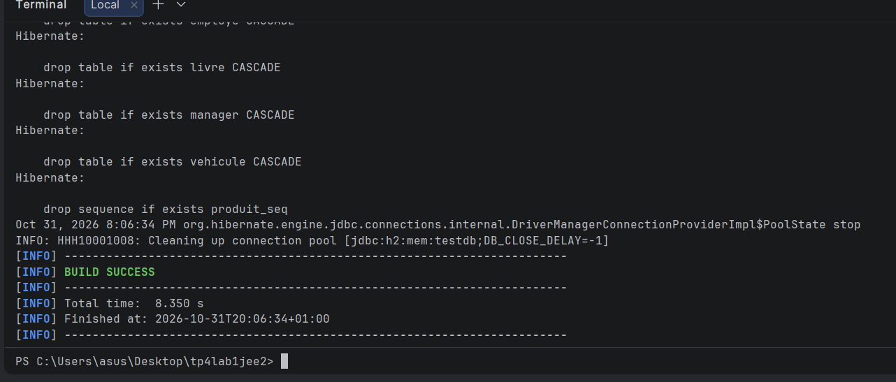

# TP — Héritage JPA avec Hibernate

Projet Maven illustrant les stratégies `SINGLE_TABLE`, `JOINED` et `TABLE_PER_CLASS` avec Hibernate et une base H2 en mémoire.

## Technologies

- JDK 11 ou supérieur et Maven 3.6 ou supérieur.
- JPA 2.2 (`javax.persistence`), Hibernate 5.4.30.Final et H2 1.4.200, conformément à l'énoncé.
- `exec-maven-plugin` pour lancer la classe `com.example.App`.

## Organisation

```text
tp4lab1jee2/
├── pom.xml
├── .gitignore
├── README.md
├── docs/screenshots/
└── src/main/
    ├── java/com/example/
    │   ├── App.java
    │   └── model/
    │       ├── singletable/   (Vehicule, Voiture, Moto)
    │       ├── joined/        (Employe, Developpeur, Manager)
    │       └── tableperclass/ (Produit, Livre, Electronique)
    └── resources/META-INF/persistence.xml
```

## Personnalisation du modèle

Les attributs de l'énoncé sont conservés. Les champs suivants enrichissent le projet :

| Entité | Champs ajoutés | Utilité |
| --- | --- | --- |
| Vehicule | immatriculation, anneeFabrication | Identification unique et année de fabrication |
| Voiture | carburant | Type de motorisation |
| Moto | cylindree | Cylindrée en cm³ |
| Employe | email, salaire | Contact unique et rémunération en MAD |
| Developpeur | niveau | Niveau d'expérience |
| Manager | departement | Service encadré |
| Produit | prix, stock | Prix en MAD et quantité disponible |
| Livre | isbn | Identification unique du livre |
| Electronique | marque | Fabricant |

Les montants utilisent `BigDecimal` et des colonnes décimales à deux chiffres après la virgule. Les contraintes SQL imposent l'unicité des immatriculations, des emails et des ISBN dans leurs tables respectives. Les entités possèdent des constructeurs sans argument, des accesseurs et un affichage des données métier.

## Comparaison des stratégies

| Stratégie | Tables métier | Lecture polymorphique | Compromis |
| --- | --- | --- | --- |
| SINGLE_TABLE | vehicule | Une seule table, colonne vehicule_type | Lecture simple ; colonnes spécifiques nulles pour l'autre sous-classe |
| JOINED | employe, developpeur, manager | Jointures sur les identifiants | Attributs répartis entre parent et enfants ; jointures nécessaires |
| TABLE_PER_CLASS | livre, electronique | Union des tables concrètes | Colonnes communes répétées dans les deux tables |

Pour `TABLE_PER_CLASS`, une séquence commune `produit_seq` génère les identifiants des deux sous-classes. Elle évite les collisions d'identifiants entre produits et convient à cette stratégie, contrairement à `IDENTITY` avec Hibernate.

Les performances dépendent du volume, des requêtes et des index ; ce TP illustre les mappings sans constituer un benchmark.

## Fonctionnement

`App` crée deux objets par hiérarchie, puis effectue les opérations suivantes :

1. Insertion des six entités dans une transaction.
2. Vidage du contexte de persistance avec `clear()` et lecture polymorphique des trois hiérarchies.
3. Vérification des sous-classes et des champs supplémentaires rechargés depuis la base.
4. Modification d'un champ de chaque sous-classe, validation de la transaction et nouvelle lecture pour vérifier la persistance des changements.
5. Suppression des six entités et contrôle de leur absence dans chaque hiérarchie.

Une vérification incorrecte déclenche une `IllegalStateException`. Les transactions encore actives sont annulées en cas d'erreur et les ressources JPA sont fermées.

## Tester avant le dépôt sur GitHub

Les commandes suivantes sont à lancer toi-même depuis le dossier contenant ce `pom.xml`. Le projet n'a pas été compilé ni exécuté lors de sa préparation.

### 1. Vérifier les outils

```powershell
cd C:\Users\asus\Desktop\tp4lab1jee2
java -version
mvn -version
```

Vérifier que Maven utilise un JDK 11 ou supérieur. Dans l'IDE, importer ce dossier comme projet Maven et actualiser les dépendances. Le premier téléchargement nécessite un accès à Internet.

### 2. Compiler et produire le JAR

```powershell
mvn clean package
```

Le résultat attendu est `BUILD SUCCESS`, avec un JAR dans `target/`. Cette étape vérifie la compilation et le packaging ; aucun test unitaire n'est fourni. Le JAR seul n'embarque pas les dépendances : utiliser la commande Maven ci-dessous pour lancer la démonstration.

### 3. Lancer les vérifications CRUD

```powershell
mvn exec:java
```

Alternative dans l'IDE : lancer `com.example.App` comme application Java, avec les ressources et dépendances Maven dans le classpath.

Contrôler les points suivants dans la console :

- Les trois premières listes contiennent chacune deux objets et affichent leurs champs supplémentaires.
- Après modification : carburant `Essence`, cylindrée `1250`, niveau `Senior`, département `Recherche et developpement`, stock du livre `10`, prix du smartphone `4200.00`.
- Après suppression, les listes `Vehicule`, `Employe` et `Produit` contiennent chacune zéro résultat.
- Les lignes `[OK]`, puis `=== VERIFICATIONS CRUD REUSSIES ===`, apparaissent sans exception et Maven termine par `BUILD SUCCESS`.

La base est en mémoire : elle est recréée à chaque lancement et son schéma est supprimé à la fermeture avec `create-drop`. Les données de démonstration sont également supprimées explicitement par la partie CRUD.

### 4. Examiner le SQL

Dans les requêtes affichées par Hibernate, vérifier :

- Une table `vehicule` avec la colonne discriminante `vehicule_type` et les valeurs `VOITURE` et `MOTO`.
- Les tables `employe`, `developpeur` et `manager`, leurs clés étrangères et les jointures lors de la lecture des employés.
- Les tables `livre` et `electronique`, chacune contenant les champs hérités de `Produit`, ainsi qu'un `union all` pour la requête sur `Produit`.
- Les instructions `insert`, `update` et `delete` correspondant aux opérations CRUD.

Ces éléments sont des résultats attendus à vérifier localement, pas des résultats déjà observés.

### 5. Préparer les captures et le dépôt

Placer les captures PNG dans `docs/screenshots/`, avec les noms `01.png` à `06.png`. Dans les cellules de la section finale, retirer les marqueurs de commentaire HTML autour de chaque balise `img` pour afficher les photos. Les emplacements ne contiennent aucune légende.

Créer un dépôt GitHub vide. Si ce dossier constitue un nouveau dépôt indépendant, exécuter :

```powershell
git init
git add .
git status
git diff --cached --stat
```

Vérifier que les sources, le `pom.xml`, le README et les captures sont inclus, et que `target/`, les fichiers de l'IDE et les journaux sont exclus.

```powershell
git commit -m "Ajout du TP heritage Hibernate avec champs personnalises"
git branch -M main
git remote add origin https://github.com/nouhaelbehja/tp4lab1jee2.git
git push -u origin main
```

Si le dossier appartient déjà à un dépôt existant, utiliser ce dépôt et sa configuration distante ; ne pas refaire l'initialisation ni ajouter une seconde origine. Vérifier ensuite sur GitHub que le README et les captures s'affichent.

## Captures d'écran




